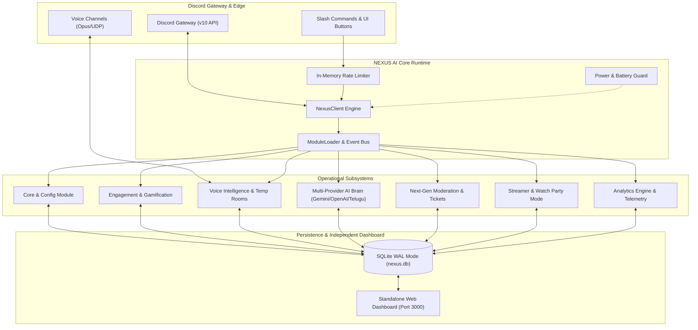

# ⚡ NEXUS AI
### The Next Generation AI-Powered Discord Community Operating System

[](https://www.typescriptlang.org/)
[](https://discord.js.org/)
[](https://www.prisma.io/)
[-0078D6.svg?logo=windows&logoColor=white)](https://microsoft.com)
[-04D090.svg?logo=android&logoColor=white)](https://termux.dev)
[](tests/)
[](LICENSE)

**NEXUS AI** is an enterprise-grade, modular, self-healing Discord community operating system and voice intelligence engine. Engineered from the ground up for extreme resource efficiency, strict security boundaries, and deep community engagement, NEXUS AI operates flawlessly on resource-constrained production hosts (**HP All-in-One PC running Windows 10 with 4GB RAM**) as well as mobile edge hosts (**OPPO Reno10 5G via Android Termux**).

---

## 🏛️ High-Level System Architecture



---

## 🌟 10 Production Subsystems

### 1. Core Engine & Administration
- **Dynamic Lifecycle**: Zero-downtime hot loading and unloading of modules with granular per-guild feature flags.
- **Hardware Telemetry Watcher**: Continuous memory and CPU monitoring tailored for 4GB RAM hosts. Automatically triggers garbage collection hooks if process RSS exceeds 400MB.
- **IANA Timezones & Locales**: Full server-specific timezone alignment for scheduling, audit logging, and automated daily resets.

### 2. Intelligent Member Engagement & Gamification
- **Progression Math**: Quadratic leveling formula $XP_{needed} = 5 \times level^2 + 50 \times level + 100$ with 60-second anti-spam cooldown protection.
- **Daily Streaks**: Progressive streak bonuses up to 30 days with a 48-hour recovery grace window.
- **14 Community Badges**: Distinct badges across progression, social interaction, and voice duration (`first_words`, `level_10`, `streak_7`, `voice_3h`, etc.).
- **Birthday & Anniversary Engine**: Automated birthday card generation with +500 XP and +250 Coins rewards.
- **Interactive Community Tools**: Live polls with real-time progress bar tallies and persistent suggestion boards with voting buttons.

### 3. Voice Intelligence & Dynamic Temporary Rooms
- **Dynamic Temporary Rooms**: Automated "➕ Create Room" detection. Spawns private user voice rooms, tracks occupancy, and automatically purges abandoned channels on 0 occupants.
- **Voice Milestones**: Automatic milestone celebrations (Voice Explorer 30m, Voice Regular 1h, Voice Champion 3h, Community Legend 5h) with duplicate-award prevention.
- **Audio Quality Advisor**: Real-time channel analysis diagnosing bitrates, jitter estimates, packet-loss thresholds, and Krisp noise suppression recommendations.
- **Privacy-First Assistant**: Strict opt-in consent flag (`isVoiceOptIn`) required before any voice intelligence operates. Zero raw audio recording.

### 4. Advanced AI Brain (Multilingual English & Telugu)
- **Multi-Provider Fallback Pipeline**: High-availability routing prioritizing Google Gemini 1.5, falling back to OpenAI GPT-4o, and ultimately to local zero-dependency rule-based engines.
- **Native Telugu Support (తెలుగు లిపి)**: Native bilingual processing responding fluently in both English and Telugu script.
- **Context-Isolated Memory**: Per-user, permission-gated conversational memory with explicit user-triggered deletion (`/ai memory clear`).
- **Server Knowledge Registry**: Administrator-approved server FAQ registry for precise community question answering.

### 5. Next-Generation Moderation & Support Tickets
- **Heuristic Threat Detection**: Real-time anti-phishing protection with homoglyph/URL obfuscation decoding, mention spam rate-limiting, duplicate spam suppression, and leetspeak normalization.
- **Automated Punishment Ladder**: Strict progressive disciplinary ladder: `Warning` ➔ `1h Timeout` ➔ `24h Timeout` ➔ `Kick` ➔ `Ban`.
- **Interactive Support Tickets**: Private thread tickets (`ticket-0001`) with interactive UI buttons (`🔒 Close`, `📜 Transcript`) and transcript exports.
- **Audit Logging**: Comprehensive evidence-backed JSON audit trails for all administrative actions.

### 6. Streamer & Content Creator Mode
- **Multi-Platform Creator Profiles**: Support for Twitch, YouTube, Kick, and Discord Go Live.
- **Automated Go Live Tracking**: Automatic broadcast announcements, streamer XP awards (+2 XP/min airtime), and broadcast leaderboards.
- **Streamer Protection System**: Silent mode toggle preventing unwanted pings and stream video privacy safeguards.
- **Community Watch Parties**: Interactive watch party scheduling with real-time RSVP buttons (`✅ Join`, `❌ Leave`).

### 7. Community Analytics Engine & Standalone Web Dashboard
- **Telemetry Aggregator**: SQLite historical rollups (`DailyMetric`), 7d/30d velocity calculations, DAU/WAU/MAU ratios, and activity anomaly detection.
- **Cyberpunk Dark UI**: Responsive single-page dashboard (<35MB RAM footprint) displaying real-time metrics, system graphs, moderation feeds, and module toggles.
- **Zero-Dependency HTTP Server**: Standalone Node HTTP server operating completely independently of the Discord bot process.
- **Bearer Token Security**: Cryptographic token authentication protecting administrative API endpoints.

### 8. Experimental AI Subsystems
- **Community Pulse**: Real-time sentiment scoring (-1.0 to +1.0), mood classification (Ecstatic, Optimistic, Neutral, Tense, Frustrated), and trending topic extraction.
- **Smart Voice Companion**: Categorized voice icebreakers (Gaming, Funny, Deep, Casual) and automated spoken announcement synthesis.
- **Server Lore & Community Memory**: Archival repository for memorable server quotes, historic community milestones, and inside jokes with upvoting.
- **Interactive Game Host**: 4-choice button Trivia (`[A] [B] [C] [D]`) and Riddles with dynamic hints, coin payouts, and community leaderboards.

### 9. Android Termux Mobile Engine (OPPO Reno10 5G Profile)
- **Dual-Mode Architecture**: Lightweight Mobile Profile bypassing native C++ audio receive dependencies to guarantee zero build crashes, while preserving voice presence, leveling, and milestone tracking.
- **PowerGuard Service**: Background CPU sleep prevention via Termux wake-lock (`termux-wake-lock`).
- **Automated Eco Mode**: Real-time battery monitoring (`termux-battery-status`) that automatically downscales background task frequency when battery drops $\le 15\%$ or device temperature exceeds $42^\circ\text{C}$, auto-recovering when battery exceeds $30\%$.
- **Strict Mobile Memory Budget**: Tuned to operate within $\le 120\text{MB}$ RSS.

### 10. Windows 10 Host (HP All-in-One 4GB RAM)
- **Low-Footprint Design**: Bot and Dashboard run in separate, isolated PM2 processes (`nexus-bot` capped at 350MB, `nexus-dashboard` capped at 100MB).
- **Auto-Restart Watchdog**: Robust batch scripts (`start-all.bat`, `start-bot.bat`, `start-dashboard.bat`) providing automatic crash recovery and reconnection loops.
- **Automated SQLite Backups**: Daily snapshot script (`backup-db.ps1`) with 7-day automated backup retention and pruning.

---

## 🎮 Complete Slash Command Directory (31 Production Commands)

| Command | Subcommands / Usage | Module | Minimum Permission | Description |
|---|---|---|---|---|
| `/nexus` | `info`, `ping`, `status`, `modules`, `enable`, `disable`, `mobile`, `ecomode` | Core | Member / Admin | Diagnostic diagnostics, module control, and mobile power telemetry. |
| `/help` | `[module]` | Core | Member | Interactive categorized command directory with dropdown selection. |
| `/admin` | `settings`, `welcome-channel`, `log-channel`, `announcement-channel`, `locale`, `timezone`, `audit-log`, `backup` | Core | Administrator | Core server administration, channel routing, and SQLite snapshots. |
| `/profile` | `[user]` | Engagement | Member | View progression card, level, XP progress bar, badges, and balance. |
| `/leaderboard` | `[type: xp \| coins \| rep \| voice]` | Engagement | Member | Display server rankings across XP, coins, reputation, and voice airtime. |
| `/daily` | None | Engagement | Member | Claim daily reward coins and advance consecutive streak counter. |
| `/streak` | `[user]` | Engagement | Member | Inspect current streak, multiplier tier, and claim window status. |
| `/rep` | `<user>` | Engagement | Member | Award a community reputation point to a helpful member (24h cooldown). |
| `/birthday` | `set <MM-DD>`, `view [user]`, `upcoming` | Engagement | Member | Register birthday, view celebrate dates, and list upcoming celebrations. |
| `/intro` | `<text>` | Engagement | Member | Submit personal member introduction to community onboarding channel. |
| `/suggest` | `<suggestion>` | Engagement | Member | Post an interactive community suggestion with upvote/downvote buttons. |
| `/poll` | `<question> <options...>` | Engagement | Member | Launch an interactive multi-choice poll with real-time button voting. |
| `/feedback` | `<message>` | Engagement | Member | Submit confidential community feedback to server administrators. |
| `/achievements` | `[user]` | Engagement | Member | View unlocked and locked community badges and milestones. |
| `/voice` | `stats`, `milestones`, `create`, `join`, `leave`, `advisor`, `consent`, `rooms`, `autojoin <enable\|disable\|channels>`, `greeting <enable\|disable>` | Voice | Member / Admin | Voice activity stats, temporary rooms, assistant, audio advisor, and auto-join policies. |
| `/heart` | `profile [user]`, `achievements [user]`, `rewards <browse\|buy>`, `settings [personality] [language]`, `privacy [consent] [delete_data]`, `notifications <pings>`, `leaderboard` | Voice | Member | Sweet Voice Companion — companion profiles, milestone progression, reward shop, and privacy controls. |
| `/ai` | `ask <prompt>`, `summarize`, `announce <topic>`, `faq <question>`, `memory <view\|clear>` | AI | Member | Multi-provider bilingual conversation, summarization, and facts FAQ. |
| `/pulse` | `[sample_size]` | AI | Member | Real-time community sentiment score, mood classification, and trends. |
| `/companion` | `icebreaker [category]`, `recap`, `announce <title>` | AI | Member | Voice icebreaker generator, session recap synthesizer, and spoken scripts. |
| `/lore` | `list`, `search <term>`, `add <category> <title> <content>`, `upvote <id>`, `delete <id>` | AI | Member | Community memory registry: server quotes, inside jokes, and milestones. |
| `/game` | `trivia [category]`, `riddle`, `leaderboard` | AI | Member | Interactive 4-choice button trivia, riddles with hints, and game rankings. |
| `/warn` | `<user> <reason>` | Moderation | Moderator | Issue a formal warning, incrementing infraction counter on punishment ladder. |
| `/timeout` | `<user> <duration> [reason]` | Moderation | Moderator | Place an unruly member in temporary timeout (e.g. `10m`, `1h`, `1d`). |
| `/untimeout` | `<user> [reason]` | Moderation | Moderator | Remove an active timeout from a member. |
| `/kick` | `<user> [reason]` | Moderation | Moderator | Kick a member from the server with recorded audit trail. |
| `/ban` | `<user> [reason] [delete_days]` | Moderation | Moderator | Permanently ban a user and purge recent messages with evidence logging. |
| `/unban` | `<user_id> [reason]` | Moderation | Moderator | Revoke a ban for a specified user ID. |
| `/mod` | `history <user>`, `clear <user>`, `antiraid <on\|off>` | Moderation | Moderator | Query infraction histories, purge records, and toggle anti-raid shield. |
| `/ticket` | `create <topic>`, `panel <channel>` | Moderation | Member | Open a private support thread ticket or spawn an interactive ticket panel. |
| `/streamer` | `register`, `profile [user]`, `mode <silent>`, `leaderboard`, `lounge <create>` | Streamer | Member | Register creator accounts, view airtime, toggle silent mode, and create lounges. |
| `/watchparty` | `schedule <title> <streamer_url> <start_time>`, `list` | Streamer | Member | Schedule community stream watch parties with interactive RSVP buttons. |
| `/analytics` | `overview`, `telemetry` | Analytics | Administrator | Display 7d/30d activity velocity, engagement score, and hardware telemetry. |

---

## 💻 Deployment: Windows 10 Host (HP All-in-One 4GB RAM)

### 1. System Requirements & Preparation
- **OS**: Windows 10 (64-bit)
- **Node.js**: v20 LTS or later installed ([nodejs.org](https://nodejs.org/))
- **RAM Footprint**: Configured to run within 450MB combined RAM (350MB Bot + 100MB Dashboard).

### 2. Installation
Open PowerShell or Command Prompt in your destination folder:
```cmd
git clone <repo-url> dc-bot
cd dc-bot
npm install
```

### 3. Environment Configuration
Copy `.env.example` to `.env`:
```cmd
copy .env.example .env
```
Populate your credentials in `.env`:
```env
DISCORD_TOKEN=your_bot_token_here
DISCORD_CLIENT_ID=your_client_id_here
DISCORD_CLIENT_SECRET=your_client_secret_here
GUILD_ID=your_primary_discord_server_id

DATABASE_URL="file:./data/nexus.db"
NODE_ENV=production
DEPLOYMENT_MODE=server

# AI Providers (Google Gemini or OpenAI)
AI_PROVIDER=gemini
GEMINI_API_KEY=your_gemini_api_key_here

# Standalone Web Dashboard
DASHBOARD_PORT=3000
DASHBOARD_AUTH_TOKEN=choose_a_secure_admin_token
```

### 4. Database Synchronization & Build
```cmd
npm run db:generate
npm run db:push
npm run build
```

### 5. Register Slash Commands
```cmd
# Deploy to your development server (instant):
npm run deploy:commands

# Or deploy globally to all servers:
npx tsx scripts/deploy-commands.ts --global
```

### 6. Production Execution Options

#### Option A: 1-Click Batch Runner (No PM2 Required)
Double-click `scripts\windows\start-all.bat` or run:
```cmd
scripts\windows\start-all.bat
```
*This automatically launches both the Bot process and Web Dashboard in dedicated, auto-restarting terminal windows.*

#### Option B: PM2 Background Service (Recommended for Windows)
Install PM2 globally and configure Windows startup:
```cmd
scripts\windows\install-service.bat
```
*This configures PM2 to automatically start NEXUS AI on Windows boot, enforce the 350MB memory ceiling, and write to `./logs`.*

Useful PM2 commands:
```cmd
pm2 status                  :: View running processes
pm2 logs nexus-bot          :: View live bot logs
pm2 logs nexus-dashboard    :: View live web dashboard logs
pm2 restart all             :: Restart bot and dashboard
```

#### Option C: Automated SQLite Backups
Run or schedule the PowerShell backup script:
```powershell
powershell -ExecutionPolicy Bypass -File scripts\windows\backup-db.ps1
```
*Creates timestamped snapshots in `data/backups/` and automatically prunes backups older than 7 days.*

---

## 📱 Deployment: Android Termux (OPPO Reno10 5G)

NEXUS AI is specifically optimized for Android Termux with dual-mode voice support, native audio receive bypass, wake-lock CPU management, and battery protection.

### 1. Termux Initial Setup
Open the Termux app on your OPPO Reno10 5G:
```bash
# Update repositories and install git
pkg update -y && pkg upgrade -y
pkg install -y git

# Clone repository
git clone <repo-url> dc-bot
cd dc-bot

# Run the automated Termux setup script
bash scripts/termux/setup.sh
```

### 2. Configure Environment
```bash
cp .env.example .env
nano .env
```
Ensure `DEPLOYMENT_MODE=android` is set.

### 3. Launch in Mobile Mode
```bash
bash scripts/termux/start.sh
```
*What this script does:*
1. Sets `DEPLOYMENT_MODE="android"` and activates the Lightweight Mobile Profile.
2. Acquires an Android CPU wake-lock (`termux-wake-lock`) to prevent OS sleep when screen is off.
3. Automatically releases the wake-lock cleanly on process exit.
4. Starts the auto-recovery watchdog loop.

### 4. Battery & Eco Mode Monitoring
Check mobile battery status and active power profiles anytime:
```bash
bash scripts/termux/eco-mode.sh
```
*In Discord, type `/nexus mobile` or `/nexus ecomode enabled:true` to inspect or toggle power conservation.*

---

## ☁️ Deployment: Oracle Cloud Free Tier (24/7 VPS)

You can host NEXUS AI **100% free forever** on **Oracle Cloud Infrastructure (OCI) Always Free Tier** with zero hardware costs.

- **Specs**: Up to 4 Ampere A1 (ARM64) OCPUs, 24 GB RAM, 200 GB SSD storage, static IPv4 address.
- **Uptime**: 99.99% enterprise cloud uptime.
- **Detailed Step-by-Step Guide**: Read [docs/ORACLE_CLOUD_DEPLOYMENT.md](docs/ORACLE_CLOUD_DEPLOYMENT.md).

### Quick 2-Minute Setup on Oracle Cloud VM (Ubuntu):
```bash
# 1. Clone repository
git clone <repo-url> dc-bot
cd dc-bot

# 2. Run automated setup script
chmod +x scripts/linux/setup.sh scripts/linux/start.sh
./scripts/linux/setup.sh

# 3. Configure .env with your bot token
nano .env

# 4. Deploy slash commands and launch 24/7 with PM2
npm run deploy:commands
./scripts/linux/start.sh
```

---

## 🌐 Web Dashboard & Remote Access

NEXUS AI includes a standalone Cyberpunk Dark web dashboard running on port 3000.

### 1. Local Network Access
Visit `http://localhost:3000` on the HP All-in-One host.

### 2. Remote Access over Local LAN
Find your host's local IP (e.g. `192.168.1.50`) and open:
`http://192.168.1.50:3000` from any device on your Wi-Fi network.

### 3. Remote Access over the Internet (Cloudflare Tunnel)
To securely access your dashboard remotely without opening router ports:
```cmd
cloudflared tunnel --url http://localhost:3000
```
Use the provided HTTPS URL and authenticate using your `DASHBOARD_AUTH_TOKEN`.

### 4. Dashboard REST API Reference
- `GET /health` or `GET /api/health` — Public health check & uptime status.
- `GET /api/stats` — Community message totals, voice hours, active tickets, and infractions.
- `GET /api/system` — Real-time host RAM, CPU load, process RSS, and disk metrics.
- `GET /api/analytics?days=7` — Retention rates, 7d/30d message velocity, and anomaly logs.
- `GET /api/moderation?limit=20` — Recent infractions and evidence-backed audit entries.
- `GET /api/tickets?status=open` — Active support tickets.
- `GET /api/modules` — Feature flags and module states.
- `POST /api/modules/toggle` — *(Protected)* Enable or disable modules dynamically.
- `POST /api/auth/login` — Verify admin token.

---

## 🧪 Verification & Automated Test Suites

NEXUS AI features a 100% automated verification test suite spanning all 10 phases.

```bash
# Run the complete test suite across all 10 development phases:
npm run test:all
```

| Phase | Test Suite | Tests | Coverage | Status |
|---|---|---|---|---|
| **Phase 1** | `tests/phase1.test.ts` | 35 | Core Foundation, Config, SQLite WAL, Rate Limiter, Diagnostics | ✔ PASS |
| **Phase 2** | `tests/phase2.test.ts` | 36 | Leveling Math, Daily Streaks, 14 Badges, Birthdays, Polls | ✔ PASS |
| **Phase 3** | `tests/phase3.test.ts` | 29 | Voice Duration, Milestones, Dynamic Temp Rooms, Audio Advisor | ✔ PASS |
| **Phase 4** | `tests/phase4.test.ts` | 31 | AI Multi-Provider Fallback, Telugu లిపి & English, Memory, FAQs | ✔ PASS |
| **Phase 5** | `tests/phase5.test.ts` | 49 | Heuristic Automod, Anti-Raid Shield, Punishment Ladder, Tickets | ✔ PASS |
| **Phase 6** | `tests/phase6.test.ts` | 40 | Creator Profiles, Go Live, Airtime XP, Watch Parties, Lounges | ✔ PASS |
| **Phase 7** | `tests/phase7.test.ts` | 39 | Telemetry, Metrics Velocity, Standalone HTTP Server, Web UI | ✔ PASS |
| **Phase 8** | `tests/phase8.test.ts` | 48 | Community Pulse, Voice Companion, Server Lore, Button Games | ✔ PASS |
| **Phase 9** | `tests/phase9.test.ts` | 23 | Termux Dual-Mode, Audio Bypass, Wake-Lock, Eco Mode Throttling | ✔ PASS |
| **Phase 10** | `tests/phase10.test.ts` | 34 | 32 Commands REST Serialization, DB Models, Graceful Shutdown | ✔ PASS |
| **NEXUS HEART** | `tests/heart.test.ts` | 34 | Voice Auto-Join, 5 Personalities, Milestones, Reward Shop | ✔ PASS |
| **Total** | **All Verification Suites** | **398** | **Complete Full-Stack Architecture & Release Verification** | **✔ 100% PASS** |

---

## 📄 License

This project is licensed under the MIT License — see the [LICENSE](LICENSE) file for details.
